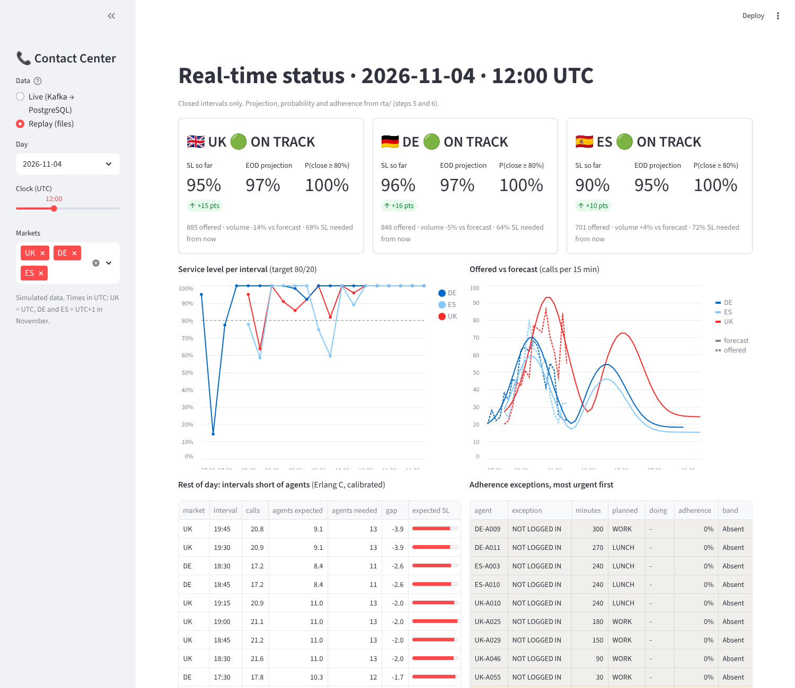

# 📞 Contact Center Analytics Platform

> Real-time and batch data platform for a multi-market contact center (UK · DE · ES).
> Call and agent events stream through **Kafka**, land in an **S3 lakehouse** (RustFS), are processed with **PySpark** and **dbt**,
> and feed live and historical dashboards with the KPIs a real-time analyst watches all day:
> service level, abandon rate, occupancy, schedule adherence and end-of-day projections.

All data is **simulated** by a generator in this repository. It mimics the shape of contact center exports
(contact records, agent states, schedules, forecasts) but contains no real company or customer data.

> 🚧 Work in progress: this README grows with each step.

## Architecture (target)

```
generator (Python)
   │  call + agent events
   ▼
Redpanda (Kafka) ──► stream processor ──► PostgreSQL "realtime" ──► live dashboard
   │
   ▼  daily files
RustFS (S3): bronze ──► PySpark ──► silver ──► gold ──► dbt star schema ──► Power BI
```

## Roadmap

| Step | What | Tech | Status |
|---|---|---|---|
| 0 | Setup: repo, Docker Compose (Redpanda, RustFS S3 storage, PostgreSQL) | Docker | ✅ |
| 1 | Realistic data generator: contacts, agent states, schedules, forecast | Python | ✅ |
| 2 | Real time: events into Kafka, KPIs every 15 minutes | Redpanda, Python | ✅ |
| 3 | Batch lakehouse: bronze → silver → gold | RustFS (S3), PySpark | ✅ |
| 4 | Star schema + data tests | dbt | ✅ |
| 5 | Real-time analyst logic: EOD service level projection, Erlang C staffing, adherence colour code | Python, SQL | ✅ |
| 6 | Automatic intraday status message | Python | ✅ |
| 7 | Live dashboard + historical dashboard | Streamlit, Power BI | ⏳ |
| 8 | Orchestration + CI | Airflow, GitHub Actions | |

## Run it locally

Requirements: **Docker Desktop** (nothing else to install).

```bash
git clone https://github.com/AYMANETBAIK98/CONTACT-CENTER-ANALYTICS.git
cd CONTACT-CENTER-ANALYTICS

docker compose up -d                                          # start Redpanda, RustFS (S3), PostgreSQL
docker compose run --rm tools python scripts/check_setup.py   # check everything is ready
```

Expected output:

```
[OK]   PostgreSQL reachable: PostgreSQL 16.x
[OK]   PostgreSQL schemas: ['marts', 'monitoring', 'realtime', 'staging']
[OK]   Redpanda reachable: 1 broker(s) on redpanda:9092
[OK]   Kafka topics: agent-events (3 partitions), contact-events (3 partitions)
[OK]   S3 storage (RustFS) reachable on http://rustfs:9000
[OK]   S3 buckets: ['bronze', 'gold', 'silver']

Environment ready. On to step 1!
```

| Service | URL / port | Login |
|---|---|---|
| Redpanda Console (Kafka UI) | http://localhost:8080 | – |
| RustFS console (S3 UI) | http://localhost:9001/rustfs/console/ | `lakehouse` / `lakehouse123` |
| PostgreSQL | `localhost:5435`, database `contact_center` | `cc` / `cc` |
| Kafka API (from your PC) | `localhost:19092` | – |
| Live dashboard (step 7) | http://localhost:8501 | – |

Stop with `docker compose down` (data is kept). `docker compose down -v` also deletes the data.

## Step 1: the data generator

`generator/` simulates a contact center day by day, for 3 markets, and writes the files a real-time analyst
works with. Same `--seed` = same data.

```bash
docker compose run --rm tools python -m generator.generate --start 2026-11-02 --days 14
docker compose run --rm tools pytest -v tests/test_generator.py
```

| Dataset | Format | One row = | Like in real life |
|---|---|---|---|
| `forecast` | CSV | a 15-minute interval: expected contacts and handle time | the WFM forecast |
| `schedule` | CSV | a planned shift, break or lunch | the WFM schedule |
| `contacts` | JSON Lines | a call, shaped like an Amazon Connect contact trace record | the telephony export |
| `agent_events` | JSON Lines | an agent state change (LOGIN, AVAILABLE, ON_CONTACT, ACW, BREAK, LUNCH, LOGOUT) | the agent event stream |

Files land in `data/landing/<dataset>/date=YYYY-MM-DD/market=XX/`, partitioned like a data lake.

**What makes it realistic**

| Market | Opening hours (local) | Weekday volume | Talk + wrap-up |
|---|---|---|---|
| UK | Mon-Fri 8-20, Sat 9-17 | ~2,400 | 330 s + 45 s |
| DE | Mon-Fri 8-20, Sat 9-17 | ~1,800 | 360 s + 50 s |
| ES | Mon-Fri 9-21 | ~1,500 | 300 s + 40 s |

- Intraday curve with a late-morning peak, a lunch dip and an afternoon peak; Monday busiest, Saturday half.
- Actual volume misses the forecast (6 % per day, 10 % per interval), like any forecast.
- Staffing from **Erlang C** (the agents each interval needs for 80/20). Busy intervals may stay short
  (lean staffing); small teams (6 agents or fewer) are always fully staffed. 8-hour shifts, staggered breaks and lunches;
  the closing shift stays until the queue is empty.
- Agents are sometimes absent (6 %), late (12 %), overrun breaks (18 %) or log out early (5 %).
- Calls are answered in arrival order by the first free agent; callers hang up when their patience runs out.

Result over two weeks: weekday service level 87-98 % (80/20 target), Saturdays 60-80 % with a single shift;
abandon rate 0.5-15 % per day. About 1 interval in 7 is below 80 %, mostly at the morning peak and on Saturdays.
All tunable in `generator/config.py`.

## Step 2: real time with Kafka

A **producer** replays a simulated day into Redpanda (Kafka) at accelerated speed, in time order.
A **consumer** reads the events as they arrive and keeps the KPIs of every market and 15-minute interval
up to date in PostgreSQL (`realtime.interval_kpis`), printing the last closed interval like a live wallboard.

```bash
# terminal 1: start the KPI consumer (Ctrl+C to stop)
docker compose run --rm tools python -m streaming.consumer
# terminal 2: replay Wednesday 4 November at x120 (a 12-hour day in ~7 minutes)
docker compose run --rm tools python -m streaming.producer --date 2026-11-04 --speed 120
```

```
[11:00 UTC] UK LOW SL  62% abd  10% occ  97% adh  88% | DE OK  SL 100% abd   0% occ  40% adh  91% | ES OK  SL 100% abd   0% occ  43% adh  87%
```

| Topic | Events | Key |
|---|---|---|
| `contact-events` | `CONTACT_QUEUED`, `CONTACT_ANSWERED`, `CONTACT_ABANDONED`, `CONTACT_ENDED` (built from each contact record) | market |
| `agent-events` | agent state changes | market |

The key is the market: Kafka keeps the order of messages with the same key, so each market's events
arrive in the order they happened.

| KPI | Definition |
|---|---|
| Service level | contacts answered within 20 s / contacts offered |
| Abandon rate | contacts abandoned / contacts offered |
| ASA | average wait of answered contacts |
| AHT | average talk + wrap-up |
| Occupancy | time on contact or wrap-up / productive time (available + on contact + wrap-up) |
| Adherence | time doing what the schedule planned / scheduled time (work + breaks) |

Contacts are counted in the interval they were queued in; agent time is cut at interval boundaries.

**What if it crashes or runs twice?**
- The consumer rebuilds its state from the Kafka log at every start (new consumer group, read from the beginning).
- Every event has an id; an event already counted is ignored, so replaying a day never double-counts.
- Rows are written with an UPSERT on `(market, interval_start)`: rewriting an interval replaces it.

Tests (`tests/test_streaming.py`) check that KPIs counted event by event equal the batch truth,
that a replayed day gives the same numbers, and that adherence drops when a break runs long.
`tests/test_erlang.py` checks the Erlang C formula against published table values.

## Step 3: the lakehouse (bronze → silver → gold) with PySpark

```bash
docker compose build spark                                              # once: Spark 3.5 + Java 17 image
docker compose run --rm tools python scripts/ingest_bronze.py          # landing files -> s3://bronze (as-is)
docker compose run --rm spark spark-submit spark/silver.py             # bronze -> silver (clean Parquet)
docker compose run --rm spark spark-submit spark/gold.py               # silver -> gold (+ PostgreSQL "lakehouse")
docker compose run --rm spark pytest -v tests/test_lakehouse.py
```

The first Spark run downloads two libraries from Maven Central (hadoop-aws for `s3a://`, the PostgreSQL JDBC
driver); they are cached in the `ivy_cache` volume.

| Layer | Where | What | Rules |
|---|---|---|---|
| **Bronze** | `s3://bronze/<dataset>/date=/market=/` | the landing files, untouched | idempotent upload: same MD5 = skipped |
| **Silver** | `s3://silver/<table>/date=/market=/` (Parquet) | `contacts`, `agent_states`, `schedule`, `forecast`, `quarantine` | explicit schemas, flattened JSON, typed timestamps, quality rules, deduplication |
| **Gold** | `s3://gold/<table>/date=/` (Parquet) + PostgreSQL `lakehouse.*` | `interval_kpis`, `agent_daily`, `daily_market` | business tables for dbt and dashboards |

**Silver highlights**
- Data-quality rules (missing id, unreadable timestamp, dequeue before enqueue, negative durations, unknown state):
  a broken row goes to `silver/quarantine` **with its reason** instead of silently disappearing.
- Duplicates (the same contact or event delivered twice) are kept once.
- `agent_states` is built with a window function (`LEAD`): each state lasts until the agent's next event.
- Reruns are idempotent: dynamic partition overwrite replaces only the partitions a run writes.

**Gold tables**

| Table | One row per | Main columns |
|---|---|---|
| `interval_kpis` | market × 15 min | forecast vs offered, SL, abandon, ASA, AHT, occupancy, adherence, agents scheduled / productive |
| `agent_daily` | agent × day | absent, late login (min), pause overrun (min), contacts handled, AHT, adherence |
| `daily_market` | market × day | end-of-day report: SL, abandon, forecast error, intervals below target, absent agents |

**Batch = streaming.** `tests/test_lakehouse.py` recomputes a day with Spark and checks that every interval's KPIs
equal the ones the Kafka consumer computes event by event (step 2). Building that test found a real bug:
two agent events at the same millisecond (`LOGIN` then `AVAILABLE`) were sometimes ordered the wrong way,
leaving the agent "not productive" for hours. Silver now orders ties `LOGIN` first, `LOGOUT` last.

## Step 4: star schema with dbt

```bash
docker compose build tools                     # once: adds dbt to the tools image
docker compose run --rm tools dbt build        # seed + 9 models + 41 data tests
docker compose run --rm tools dbt docs generate
```

dbt reads the gold tables Spark copied to PostgreSQL (`lakehouse.*`) and builds two layers:

| Layer | Schema | Materialized | What |
|---|---|---|---|
| **staging** | `staging` | views | `stg_interval_kpis`, `stg_agent_daily`, `stg_daily_market`: same rows, clean names, exact `numeric` types, UTC `timestamptz` |
| **marts** | `marts` | tables | the star schema below, read by Power BI |

```
              dim_date ──┐            ┌── dim_interval (96 local 15-min slots)
                         ▼            ▼
 dim_market ──►  fct_interval   (market × 15 min: counts, SL, abandon, occupancy, staffing gap)
     │
     └──────►  fct_agent_day ◄── dim_agent   (agent × day: late, pause overrun, adherence band)
```

- `dim_market` comes from a **seed** (`seeds/markets.csv`): reference data kept in Git (time zone, opening hours, 80/20 target).
- `dim_interval` is in **local time**: "the 11:00 slot" is 11:00 in London for UK and 11:00 in Madrid for ES.
- Facts keep the **counts** (offered, answered, answered in SL) next to the ratios, so a day or a week is re-aggregated
  correctly: SL = `sum(answered_in_sl) / sum(offered)`, never the average of interval SLs.
- `fct_agent_day.adherence_band` is the wallboard colour code: Green ≥ 90 %, Amber ≥ 85 %, Red below, Absent.

**Data tests (41)**: unique and not-null keys, every fact key exists in its dimension (`relationships`),
ratios between 0 and 1, markets limited to UK/DE/ES, answered in SL never above answered, and a reconciliation test:
the intervals of each market and day must add up to the end-of-day report (`daily_market`).
Custom generic tests live in `dbt/contact_center/tests/generic/` (no external package needed).

## Step 5: real-time analyst logic

### 5a. End-of-day service level projection

The question a real-time analyst answers all day: *"It is 12:00, SL so far is 84 %. Where will we close,
and what SL do we need from now on to still close at 80 %?"*

```bash
# live, from the KPIs the Kafka consumer writes (step 2 running)
docker compose run --rm tools python -m rta.eod --date 2026-11-04 --at 12:00
# or replay the day from the files, with every remaining interval
docker compose run --rm tools python -m rta.eod --date 2026-11-04 --at 12:00 --source files --detail
docker compose run --rm tools python -m rta.backtest            # how far can we trust it?
```

```
DE ON TRACK    SL so far   96% | projected EOD   97% | needed from now   64% | volume x0.95 | worst gap 18:30 -2.6 agents
ES ON TRACK    SL so far   90% | projected EOD   95% | needed from now   72% | volume x1.04 | worst gap 19:30 -1.7 agents
UK ON TRACK    SL so far   95% | projected EOD   97% | needed from now   68% | volume x0.86 | worst gap 19:30 -3.9 agents
```

How `rta/projection.py` gets there (times in UTC):
1. **What happened**: closed intervals so far (offered, answered within 20 s, agents productive, AHT).
2. **Re-forecast**: today runs X % above or below forecast, so the rest of the day is scaled the same way (volume and AHT).
3. **Real staffing**: planned agents × the share actually productive today (absences, late logins, long breaks).
4. **Erlang C, calibrated on today**: Erlang C assumes nobody hangs up, so it over-estimates the queue.
   The closed intervals show by how much (calls really missed / calls Erlang C would have missed), and the
   remaining intervals are corrected by that factor.
5. **Projected EOD SL** = (in SL so far + expected in SL later) / (offered so far + expected later),
   the **SL needed from now on**, a status (ON TRACK, AT RISK, TARGET LOST, SECURED) and the agents each
   remaining interval is short.

**Backtest** (12 simulated days × 3 markets, `rta.backtest`): mean absolute error of the projected close,
against "the day ends like it is now":

| At (UTC) | Projection | SL so far |
|---|---|---|
| 10:00 | **2.4 pts** | 9.6 pts |
| 12:00 | **0.8 pts** | 4.7 pts |
| 14:00 | **0.8 pts** | 1.8 pts |
| 16:00 | **0.6 pts** | 0.8 pts |

Right call on "will we close above 80 %?" in 130 of 134 projections (97 %). The calibration of step 4 is what
made it work: plain Erlang C was 5.9 points too pessimistic at 10:00.

### 5b. Live adherence wallboard

```bash
docker compose run --rm tools python -m rta.wallboard --date 2026-11-04 --at 10:20
docker compose run --rm tools python -m rta.wallboard --date 2026-11-04 --at 10:20 --market UK --all
```

```
UK: 44 agents planned now, 8 out of adherence | Green 35 Amber 4 Red 2 Absent 3
   UK-A010  Absent    0%  planned WORK   doing -           NOT LOGGED IN for 140 min
   UK-A004  Green    90%  planned WORK   doing BREAK       PAUSE OVERRUN for 5 min
   UK-A005  Green    96%  planned BREAK  doing ACW         WORKING IN PAUSE for 5 min
```

For every scheduled agent (`rta/adherence.py`): what the schedule says now, what the agent is doing, how long they
have been out of adherence without interruption, and the exception to act on, most urgent first:

| Exception | When |
|---|---|
| `NOT LOGGED IN` | planned on WORK, not logged in (late, absent, logged out early) |
| `PAUSE OVERRUN` | planned back on WORK, still in the break or lunch that just ended |
| `UNPLANNED PAUSE` | planned on WORK, in a pause the schedule does not have now |
| `WORKING IN PAUSE` | planned on a pause, still on a contact (often finishing a call) |

Adherence so far today gets the wallboard colour: Green ≥ 90 %, Amber ≥ 85 %, Red below (same bands as dbt
`fct_agent_day`). A test checks that adherence added up agent by agent equals the adherence the Kafka consumer
computes interval by interval: one definition everywhere.

## Step 6: automatic intraday status message

The update a real-time analyst sends to team managers, ops and WFM several times a day, written in one command
from the projection (5a) and the wallboard (5b). Plain text, ready to paste into Teams, Slack or an email
(also saved to `reports/`).

```bash
docker compose run --rm tools python -m rta.status_message --date 2026-11-04 --at 12:00 --source files
```

```
RTM UPDATE – 2026-11-07 (closed intervals up to 12:00 UTC)

🇬🇧 UK
Global: SL 🔴 54% | EOD Projection 65% | 0% Probability | 🔴 HIGH Risk
* Day so far: 568 offered, 21% abandoned, volume +2% vs forecast.
* Lowest interval: 11:00 at 1% (68 offered).
* Rest of day: 103% SL needed from now to close at 80%; short: 14:45 (-10), 15:00 (-11), 15:15 (-10).
* Adherence: 🟢 18 | 🟡 1 | 🔴 2 | absent 1.
RTM priority – Team Managers/Ops/WFM: cover 15:00 (moving breaks / overtime).
Target out of reach today: priority is to limit abandons and protect tomorrow.
```

**Probability of closing on target**: the backtest shows the projection error shrinks as the day goes on, so the
uncertainty is modelled as 0.5 point + 4 points × the share of the day's calls still to come, and the probability is
the normal-curve chance that the close lands above 80 %. Risk: LOW ≥ 90 %, MEDIUM ≥ 60 %, HIGH below.

## Step 7: dashboards

### 7a. Live dashboard (Streamlit)

```bash
docker compose build dashboard                 # once: same image as tools, with Streamlit
docker compose up -d dashboard                 # then open http://localhost:8501
```



The real-time analyst's screen in the browser, built only from the step 5 and 6 logic (`rta/`):
- one card per market: SL so far, end-of-day projection, probability of closing at 80 % or more, status;
- service level per interval against the 80/20 line, offered calls against the forecast;
- the intervals of the rest of the day short of agents (calibrated Erlang C);
- adherence exceptions, most urgent first, coloured by adherence band;
- the intraday status message of step 6, ready to paste.

Two modes: **Replay** (no Kafka, a slider moves the clock through a simulated day) and **Live**: start the consumer
and the producer of step 2 and the page refreshes itself as `realtime.interval_kpis` fills up.

## Project structure

```
├── docker-compose.yml   # infrastructure: Redpanda, RustFS (S3), PostgreSQL + a Python "tools" container
├── Dockerfile.tools     # the tools container (Python 3.11 + libraries)
├── Dockerfile.spark     # the spark container (Spark 3.5, Java 17, Python)
├── sql/init.sql         # PostgreSQL schemas, created on first start
├── scripts/             # setup check, bucket creation, bronze ingestion
├── generator/           # step 1: simulated contact center data + Erlang C
├── streaming/           # step 2: Kafka producer, KPI consumer, shared KPI logic
├── spark/               # step 3: PySpark jobs (silver.py, gold.py) + Spark config
├── dbt/contact_center/  # step 4: dbt project (seed, staging, marts, tests)
├── rta/                 # step 5: real-time analyst logic (EOD projection, backtest, adherence wallboard, status message)
├── dashboards/live/     # step 7a: Streamlit live dashboard
├── tests/               # pytest
└── docs/                # documentation
```

## Notes
- **Why RustFS and not MinIO?** MinIO is the usual local S3, but its Docker images were removed in 2026.
  RustFS speaks the same S3 API, so the code (boto3, Spark `s3a://`) is identical to what would run on AWS S3.
